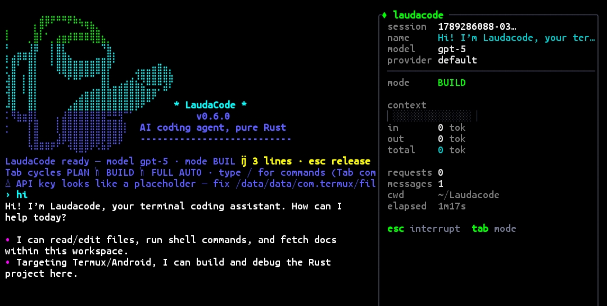

<div align="center">

# Laudacode

**A terminal-native AI coding agent built in Rust.**

Read, edit, search, run, and verify code through a fast, approval-driven TUI.<br/>
Runs on Termux, Linux, and macOS. Connects to any OpenAI-compatible API.

[](https://github.com/Anon4You/Laudacode/actions/workflows/ci.yml)
[](https://github.com/Anon4You/Laudacode/releases)
[](https://www.rust-lang.org)
[](LICENSE)



</div>

---

## Overview

Laudacode is a coding agent that runs entirely in your terminal. It reads the
workspace, edits files, runs commands, searches code, queries language servers,
and fetches documentation, with every mutation governed by configurable
approval rules.

It is distributed as a single Rust binary. There is no Node.js runtime, no
bundled toolchain, and no OpenSSL dependency. Requests are made over rustls and
work with OpenAI, OpenRouter, Groq, DeepSeek, Together, Ollama, LM Studio,
llama.cpp, vLLM, and any other OpenAI-compatible endpoint.

| | |
|---|---|
| **Runtime** | Rust 1.75+, Tokio, reqwest with rustls |
| **Platforms** | Termux/Android, Linux, macOS |
| **Interface** | Interactive TUI, one-shot execution, JSON event output |
| **Providers** | Any OpenAI-compatible API; keyless presets included |
| **License** | MIT |

### Design principles

- **Local execution, explicit network traffic.** Tools operate on your machine;
  Laudacode's own network calls are limited to model requests and tools you
  invoke. MCP servers and hooks run as separate programs under your rules.
- **Review before mutation.** Edits produce diffs, dangerous commands are
  classified, and every write path is containment-checked.
- **Boring dependencies.** Pure Rust, rustls, and a small, auditable toolset.
- **Terminal-first ergonomics.** Keyboard and touch input, narrow-terminal
  layout, streaming output, and persistent sessions.

## Contents

- [Features](#features)
- [Install](#install)
- [Quick start](#quick-start)
- [Configuration](#configuration)
- [Security model](#security-model)
- [CLI reference](#cli-reference)
- [Interactive reference](#interactive-reference)
- [Development](#development)
- [License](#license)

## Features

### Agent capabilities

| Feature | Description |
|---|---|
| Agentic tool loop | Plans and executes multi-step tasks with model-selected tools. |
| File operations | `list_dir`, `read_file`, `write_file`, `edit_file`, `apply_patch`. |
| Search | `grep`, `glob`, regex mode, ignore rules, and context lines. |
| Shell and processes | `run_command` plus managed dev servers, watchers, and REPLs. |
| Web access | `fetch_url` and DuckDuckGo-backed `web_search`. |
| Local Git | Fixed allowlist for status, log, diff, show, blame, add, commit, branch, checkout, and stash. Push/fetch/reset go through the visible shell gate. |
| Parallel reads | Independent read-only tool calls in one turn run concurrently; results remain in call order. |
| Sub-agents | `delegate` fans work out to `planner`, `researcher`, `coder`, `reviewer`, and `tester` with isolated contexts and reduced toolsets. |
| Skills | Markdown playbooks from user or workspace skill directories, loaded through a searchable picker. |
| Custom commands | Markdown commands in `.laudacode/commands/` with `$ARGUMENTS` and `$1`–`$9` expansion. |
| Project instructions | `AGENTS.md` is loaded automatically; `/init` generates one. |
| Image input | Attach screenshots and photos for vision-capable models. |

### Safety and control

| Feature | Description |
|---|---|
| Approval modes | `suggest` (PLAN), `auto-edit` (BUILD), and `full-auto` with dangerous-command confirmation. |
| Per-tool permissions | Glob rules for shell, edits, reads, web fetches, and MCP tools. Last match wins. |
| Workspace containment | Symlink-aware path checks and atomic writes that refuse to escape the workspace. |
| Secret-file blocking | `.env*` and similar secret-bearing paths are denied to tools unless explicitly allowed. |
| Transactional patches | Multi-file patches stage every hunk before writing and roll back on failure. |
| Multi-turn undo | `/undo N` reverts file changes from the last N agent turns. |
| Budget guardrails | Token and cost ceilings, per-model pricing, and delegated-spend accounting. |
| Output isolation | MCP and LSP children receive an allowlisted environment, not API keys or cloud credentials. |
| Structured logs | Optional JSONL trail for tool calls, usage, hooks, and budget blocks; prompts and file contents are excluded. |
| Prompt defaults | No answer means deny. Enter and EOF both reject an approval prompt. |

### Integrations and operations

| Feature | Description |
|---|---|
| MCP servers | Any stdio MCP server; tools exposed as `mcp__<server>__<tool>`, with paged listings, timeouts, and collision rejection. |
| Language servers | Any stdio LSP server, with per-extension `languageId` mapping, diagnostics, definitions, references, symbols, and hover. |
| Post-edit hooks | Formatters, linters, and tests run after mutations; the result is fed back to the model. |
| Retries and proxies | Jittered backoff honoring `Retry-After`, plus HTTP/SOCKS5 proxies and custom CA bundles. |
| Session persistence | Continue, resume by id or name, archive, search, rename, and delete sessions. |
| Checkpoints | Snapshot a conversation and branch from any checkpoint. |
| Observability | `/status`, `/usage`, `/doctor`, and `/mcp`/`/lsp` diagnostics. |
| Automation | `exec` mode, `--json`, `--quiet`, profiles, and documented exit codes. |

### Terminal experience

| Feature | Description |
|---|---|
| Streaming UI | Token streaming, reasoning-model output, live tool status, and elapsed time. |
| Syntax highlighting | Code blocks and diffs for Rust, Python, JavaScript/TypeScript, Go, C/C++, Java, shell, TOML, YAML, and JSON. |
| Themes | 17 built-in color themes, applied consistently across the UI. |
| Adaptive layout | Banner art collapses to a one-line header on small screens. |
| Touch support | Swipe to scroll, tap picker rows, and tap the composer to place the caret. |
| Prompt history | Persistent `↑`/`↓` recall with draft restoration. |
| Ambient effects | Optional banner-only effects, automatically paused while streaming. |

## Install

### One-line installer

```sh
curl -fsSL https://raw.githubusercontent.com/Anon4You/Laudacode/main/install.sh | sh
```

The installer resolves the latest GitHub release and prefers a checksum-verified
prebuilt binary for Termux and Linux. If no matching asset exists, it builds
from source. On Termux it installs into `$PREFIX/bin` without `sudo`; macOS
builds from source.

Requirements: `curl` and `tar`. The source fallback also needs Rust. On Termux:

```sh
pkg install curl tar rust
```

Pin a release with `LAUDACODE_VERSION=vX.Y.Z`.

### Termux / Android

```sh
pkg update && pkg install rust git -y
git clone https://github.com/Anon4You/Laudacode.git
cd Laudacode
cargo build --release
cp target/release/laudacode "$PREFIX/bin/"
```

On low-memory devices, disable LTO for the build:

```sh
CARGO_PROFILE_RELEASE_LTO=off cargo build --release
```

### Linux / macOS

```sh
cargo install --locked --git https://github.com/Anon4You/Laudacode
```

Or from a clone:

```sh
cargo install --locked --path .
```

Verify the installation:

```sh
laudacode --version
```

## Quick start

Set the three standard variables for any OpenAI-compatible provider:

```sh
export OPENAI_API_KEY="sk-or-v1-..."
export OPENAI_BASE_URL="https://openrouter.ai/api/v1"
export OPENAI_MODEL="stealth/ox-alpha"

laudacode
```

Or configure providers interactively:

```sh
laudacode                 # opens the TUI
/provider                 # add, use, edit, list, or show providers
```

`/provider add` offers presets for OpenRouter, OpenAI, Groq, DeepSeek, Together,
Cerebras, Mistral, xAI, Fireworks, SambaNova, DeepInfra, NVIDIA, Upstage,
MiniMax, Hugging Face, GitHub Models, Ollama, LM Studio, and custom endpoints.
A configuration is saved only after a live request proves the key and model
work.

Keyless presets `powerbrain` and `aitopia` need no API key. `aitopia` is the
built-in default, so a fresh installation can start immediately.

The CLI flow is also available:

```sh
laudacode provider add
laudacode provider list
laudacode provider use tokenrouter
```

Run a single task without entering the TUI:

```sh
laudacode exec "explain what this repository does"
laudacode exec "add input validation to src/main.rs" --mode full-auto
```

## Configuration

Precedence is:

```text
CLI flags > profile (--profile) > environment variables > config file
```

### Environment variables

| Variable | Purpose |
|---|---|
| `OPENAI_API_KEY` | API key |
| `OPENAI_BASE_URL` | Provider endpoint, e.g. `https://api.groq.com/openai/v1` |
| `OPENAI_MODEL` | Model name |
| `OPENAI_REASONING_EFFORT` | Optional reasoning hint |
| `LAUDACODE_CONFIG` | Config file path |
| `LAUDACODE_CONFIG_DIR` | Config directory override |
| `LAUDACODE_PROVIDER` | Active provider name |

### Config file

The default location is `~/.config/laudacode/config.toml` (JSON is also
supported). A complete annotated example is available in
[`config.example.toml`](config.example.toml).

```toml
active_provider = "openrouter"
approval_mode   = "suggest"

[providers.openrouter]
base_url = "https://openrouter.ai/api/v1"
api_key  = "sk-or-v1-..."
model    = "stealth/ox-alpha"

[providers.openrouter.headers]
"HTTP-Referer" = "https://github.com/Anon4You/Laudacode"
"X-Title"      = "Laudacode"

[profiles.fast]
provider = "groq"
model    = "llama-3.3-70b-versatile"

[limits]
max_tokens   = 500000
max_cost_usd = 5.0

[pricing."anthropic/claude-sonnet-4"]
input  = 3.0
output = 15.0

[hooks]
post_edit = ["cargo fmt", "cargo clippy --quiet -- -D warnings"]
post_edit_timeout_secs = 30

[logging]
enabled = true
file    = "~/.local/share/laudacode/session.jsonl"

[network]
proxy     = "http://127.0.0.1:8080"
ca_bundle = "~/.config/laudacode/corp.pem"
# insecure = true
```

Post-edit hooks receive touched paths in `$LAUDACODE_CHANGED_FILES`
(newline-separated). Each hook's exit status and first output line are returned
to the model. Only file-mutating tools trigger hooks.

### MCP tool servers

Laudacode hosts tools from any stdio MCP server. Tools are exposed as
`mcp__<server>__<tool>`:

```toml
[mcp_servers.files]
command      = "mcp-server-filesystem"
args         = ["--root", "."]
timeout_secs = 60
```

| Key | Default | Description |
|---|---|---|
| `command` | — | Executable to spawn (required) |
| `args` | `[]` | Arguments |
| `env` | `{}` | Additional environment variables |
| `cwd` | Agent cwd | Child working directory |
| `enabled` | `true` | Keep configuration but skip startup |
| `timeout_secs` | `60` | Per-request budget; `0` uses the default |
| `plan` | `false` | Allow the server's tools in PLAN mode |

A failed server is reported and skipped; it does not disable the rest of the
session. `/mcp` shows connection status and errors. Tool names are sanitized for
the model, while the original names are used on the wire. Two servers claiming
the same tool name are rejected.

MCP tools are third-party code whose effects cannot be inspected, so they get
no danger-based auto-approval. They ask for consent in BUILD and PLAN and are
silent only in FULL AUTO. Rules can override this per tool:

```toml
[permission.mcp]
"mcp__files__delete" = "deny"
"mcp__*"             = "ask"
```

### Language servers

Any stdio language server can provide compiler-grade diagnostics and navigation:

```toml
[lsp_servers.rust]
command = "rust-analyzer"
filetypes = { rs = "rust" }

[lsp_servers.c]
command = "clangd"
filetypes = { c = "c", h = "c" }
```

| Key | Default | Description |
|---|---|---|
| `command` | — | Executable to spawn (required) |
| `args` | `[]` | Arguments |
| `env` | `{}` | Additional environment variables |
| `filetypes` | `{}` | Extension (no dot) to LSP `languageId` |
| `enabled` | `true` | Keep configuration but skip startup |
| `root` | Agent cwd | Workspace root |
| `timeout_secs` | `90` | Per-request budget |
| `init_timeout_secs` | `120` | `initialize` handshake budget |
| `diagnostics_secs` | `5` | Time to wait for diagnostics to settle |

`filetypes` is explicit because LSP `languageId` values are server-specific. Two
servers claiming the same extension are rejected at load time.

Diagnostics are asynchronous. A first empty result does not mean the file is
clean; if the budget expires mid-analysis, Laudacode reports that analysis is
still in progress. After an edit, diagnostics are appended to the tool result
for files whose extension a configured server claims.

The `lsp` tool exposes the same servers on demand:

```json
{ "action": "diagnostics", "path": "src/main.rs" }
{ "action": "definition", "path": "src/main.rs", "line": 12, "column": 5 }
{ "action": "references", "path": "src/lib.rs", "line": 30, "column": 9 }
{ "action": "symbols" }
{ "action": "hover", "path": "src/main.rs", "line": 5, "column": 1 }
```

Positions are 1-based. They are converted internally to the protocol's 0-based
UTF-16 units.

## Security model

### Approval modes

| `--mode` | TUI label | File edits | Shell commands | Dangerous commands |
|---|---|---|---|---|
| `suggest` (alias `ask`) | PLAN | Ask | Ask | Ask |
| `auto-edit` (default) | BUILD | Automatic | Ask | Ask |
| `full-auto` (alias `yolo`) | FULL AUTO | Automatic | Automatic | Always ask |

Answer `a` (always) on a prompt to approve the remainder of the session. Switch
modes at any time with `/approvals` or `Tab`.

### Per-tool permissions

Rules are glob patterns with `allow`, `ask`, or `deny`, evaluated last match
first:

```toml
[permission.bash]
"*"     = "ask"
"git *" = "allow"
"rm *"  = "deny"

[permission.edit]
"src/**" = "allow"
```

Unmatched tools fall back to danger classification. An approval prompt is always
a denial until answered; Enter and EOF deny.

### Execution boundaries

- Write paths are checked against the canonical workspace, including symlinked
  ancestors.
- Writes use a temporary file and rename; final-component symlinks are refused.
- Secret-bearing filenames are blocked before tool execution.
- MCP and LSP children receive a minimal environment allowlist plus their
  configured overrides.
- Shell commands are classified before approval. Dangerous commands ask even in
  FULL AUTO.
- MCP tools ask for consent outside FULL AUTO and can be restricted with
  `[permission.mcp]`.
- Logs and prompt history are created with owner-only permissions on Unix.

## CLI reference

```text
laudacode                          # interactive session
laudacode "quick question"         # one-shot prompt
laudacode exec "<task>"            # same as above
laudacode exec "<task>" --json     # JSON event lines
laudacode exec "<task>" --quiet    # suppress banner; results only
laudacode -P groq -m llama-3.3-70b-versatile
laudacode --profile fast
laudacode -i screenshot.png "what is wrong with this UI?"
laudacode --base-url http://localhost:11434/v1 \
  --api-key ollama --model qwen2.5-coder:7b
laudacode -c                       # continue last session
laudacode -y                       # shorthand for --mode full-auto
laudacode provider add|list|use|edit|remove <name>
laudacode session checkpoints <id>
laudacode session branch <id> <checkpoint>
```

Exit codes: `0` success; `1` any failure, including bad arguments, provider
errors, exhausted budget, or denied tools. With `--json`, output is machine
readable and the banner is suppressed.

## Interactive reference

### Slash commands

| Command | Description |
|---|---|
| `/help` | Command overview |
| `/model` | Pick a model from the provider's live list |
| `/approvals` | Switch approval mode |
| `/agents` | List sub-agents and roles |
| `/reasoning` | Set thinking depth: low, normal, medium, high, max |
| `/provider` | Manage providers (`add`, `list`, `show`, `use`) |
| `/theme` | Switch color theme with live preview |
| `/banner` | Select a different banner logo |
| `/effect` | Select an ambient effect |
| `/status` | Provider, model, session, usage, budget, hook, log, and network state |
| `/update` | Check releases and install a newer binary |
| `/doctor` | Environment diagnostics without network or token use |
| `/usage` | Tokens and estimated cost for this session |
| `/archive` | Hide a session from `/resume` |
| `/mcp` | MCP server status, failures, and disabled servers |
| `/lsp` | Language server status, failures, and disabled servers |
| `/session` | Rename, search, list, or delete sessions |
| `/checkpoint [label]` | Mark a conversation branch point |
| `/checkpoints` | List checkpoints |
| `/branch <n\|id>` | Fork from a checkpoint |
| `/skills` | Searchable skill picker |
| `/diff` | Git diff of the working tree |
| `/review` | AI review of the current git diff |
| `/undo [N]` | Revert file changes from the last N turns |
| `/init` | Generate `AGENTS.md` |
| `/compact` | Summarize history to free context |
| `/clear` | Start a fresh conversation |
| `/retry` | Re-run the previous task |
| `/resume` | Restore a previous session |
| `/image <path>` | Attach an image to the next message |
| `/export` | Save the transcript as Markdown |
| `/quit` | Exit |

### Input prefixes

| Prefix | Effect |
|---|---|
| `@file` | Attach a file; contents are inlined into the prompt |
| `#note` | Save a memory to `AGENTS.md` |
| `!<command>` | Run a local shell command without the agent |

### Keyboard and touch

- Type `/` for command autocomplete; use `↑`/`↓` and `Tab`/`Enter` to complete.
- `Ctrl+O` expands recent tool output.
- `Esc` interrupts the agent.
- `Ctrl+B` toggles the banner.
- Swipe or use the wheel to scroll.
- Tap picker rows to select them, and tap inside the composer to place the caret.

### Skills

A skill is a directory containing `SKILL.md`. Frontmatter is optional: `name`
defaults to the directory name and `description` to the first body line.

```markdown
---
name: my-skill
description: >
  Shown in the picker and injected into the system prompt.
---
Full instructions. Only name and description reach the model; it reads this
file with `read_file` when the skill is relevant.
```

Skills are loaded from `~/.config/laudacode/skills/<name>/SKILL.md` and
`.laudacode/skills/<name>/SKILL.md`.

## Development

### Build and test

```sh
cargo build
cargo test
cargo clippy -- -D warnings
cargo build --release
```

Network-dependent tests are ignored by default. The release binary is written
to `target/release/laudacode`.

For a manual live check:

```sh
export OPENAI_BASE_URL="https://openrouter.ai/api/v1"
export OPENAI_API_KEY="<key>"
export OPENAI_MODEL="stealth/ox-alpha"
laudacode exec "list the files in this directory"
```

### Architecture

| Module | Responsibility |
|---|---|
| `src/main.rs` | Entry point, CLI dispatch, profile merging |
| `src/config.rs` | Config load/save, provider resolution, environment precedence |
| `src/agent.rs` | Agent loop, approval handling, system prompt, compaction |
| `src/api.rs` | OpenAI-compatible client, SSE streaming, tool calls, vision |
| `src/tools.rs` | Tool schemas and execution |
| `src/permissions.rs` | Allow/ask/deny rule engine |
| `src/mcp.rs`, `src/lsp.rs` | Stdio MCP and LSP clients |
| `src/session.rs` | Conversation persistence, resume, archives, checkpoints |
| `src/repl.rs`, `src/tui.rs` | Interactive interface and rendering |
| `src/patch.rs`, `src/diff.rs` | Patch application and unified diffs |

See [`AGENTS.md`](AGENTS.md) for detailed implementation invariants.

### Contributing

Issues and pull requests are welcome. Before submitting a change:

1. Run `cargo test`.
2. Run `cargo clippy -- -D warnings`.
3. Keep new dependencies out unless they are clearly justified.
4. Do not include API keys, tokens, or personal configuration in commits.

## License

MIT. See [LICENSE](LICENSE).

<div align="center"><sub>Built by Anon4You</sub></div>
